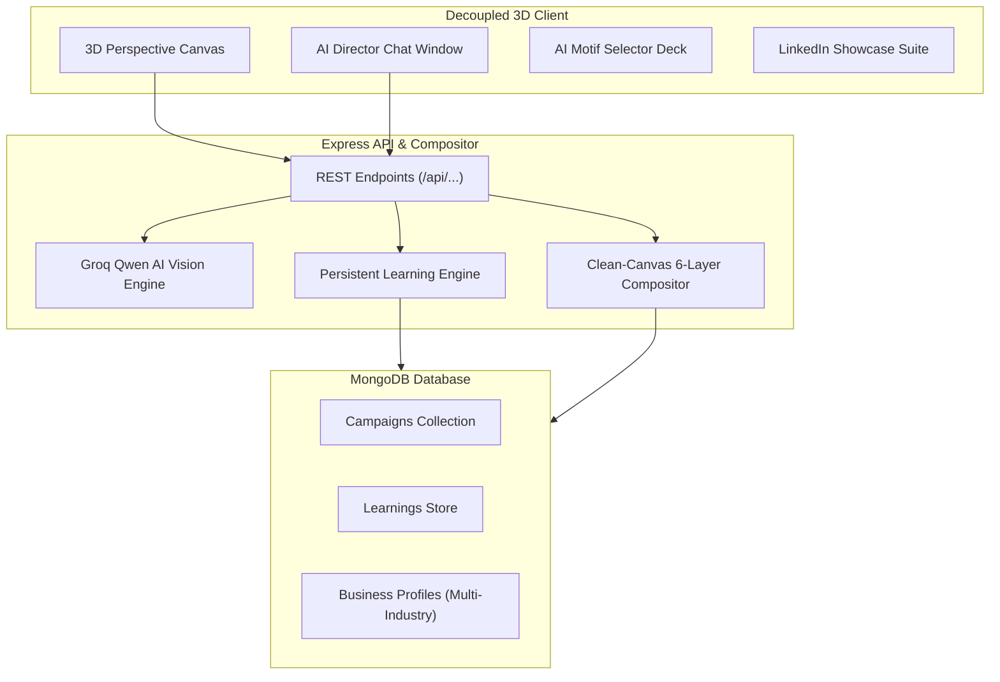

# 🪔 FestiveAgent AI — Autonomous 3D Festival Creative Director Studio

[](https://opensource.org/licenses/MIT)
[](https://nodejs.org/)
[](https://groq.com/)
[](https://mongodb.com/)
[](https://sharp.pixelplumbing.com/)

> **Autonomous Multi-Agent Creative Director generating culturally authentic, brand-preserved festive marketing campaigns across 10+ Indian & International festivals.**

---

## 🌟 Key Features

### 1. 🎨 Clean-Canvas 6-Layer Compositing Engine
- **Mathematical Zero-Bleed**: Every poster is rendered from a pristine, fresh 1085×1449 canvas. No leftover decorations from previous festivals (e.g. Christmas pine never bleeds into Eid or Holi).
- **Zone A Protected Invariants**: Strict brand lockup (`9305465848 | 9307908994 | 7355059566`, Lucknow address, authentic venue photography in arched gold frames).

### 2. 🔄 "✨ Get New Design" Dynamic Variant Engine
- Cycles through 3+ distinct thematic styles per festival (e.g. *Radiant Gold & Amber*, *Midnight Sapphire & Starlight*, *Imperial Emerald & Brass*).

### 3. 🧠 Persistent Mind & Continuous Learning Loop
- Powered by **MongoDB** (`models/Learning.js`, `models/Campaign.js`, `models/BusinessProfile.js`).
- AI Director remembers design preferences, color themes, background textures, and language rules across sessions.

### 4. 🌐 3D Interactive Studio Interface
- **Cursor-Tracking 3D Poster Tilt**: Real-time perspective physics with dynamic specular reflection glare.
- **3D AI Motif Selector Deck**: AI-generated festival artwork cards with active glow states.
- **Floating Quantum Orb**: Interactive AI Creative Director chat trigger.

---

## 🏗️ Architecture



---

## 🚀 Quickstart

### Prerequisites
- Node.js (v18+)
- MongoDB (Local or MongoDB Atlas)

### 1. Clone & Install
```bash
git clone https://github.com/<your-username>/festive-agent.git
cd festive-agent/backend
npm install
```

### 2. Configure `.env`
```env
OPENAI_API_KEY=your_groq_api_key
MONGODB_URI=mongodb://127.0.0.1:27018/festive-agent
PORT=5000
```

### 3. Run Locally
```bash
# Start Backend & AI Engine
cd backend
node server.js

# Open in browser: http://localhost:5000 or http://localhost:3000
```

---

## 💼 LinkedIn Showcase Suite
Includes a 1-click **LinkedIn Portfolio Showcase** modal with pre-formatted technical copy, architectural highlights, and print-ready 1085×1449 HD downloads.

---

## 📄 License
MIT License. Developed for **Kandhari Tent House & Dwarka Shri Lawn, Lucknow**.
